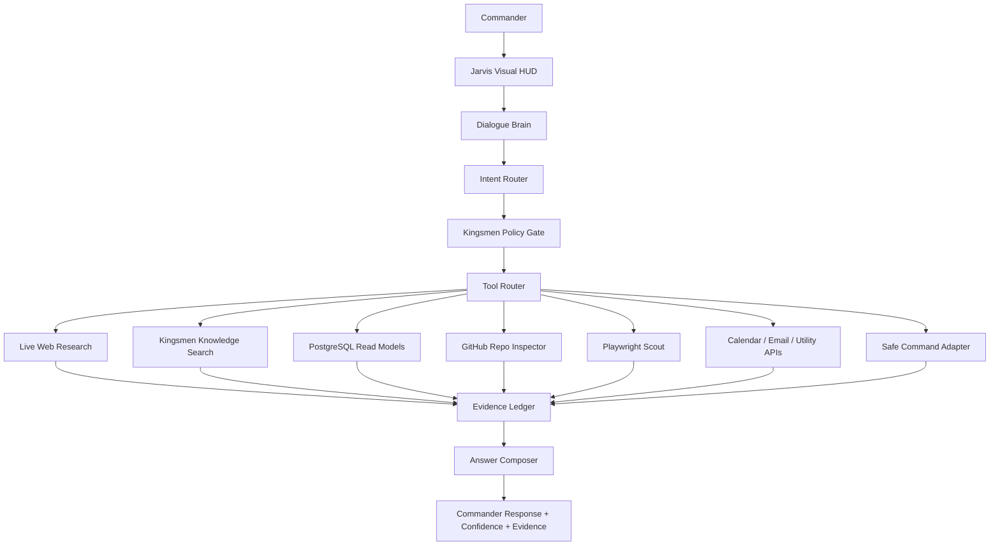
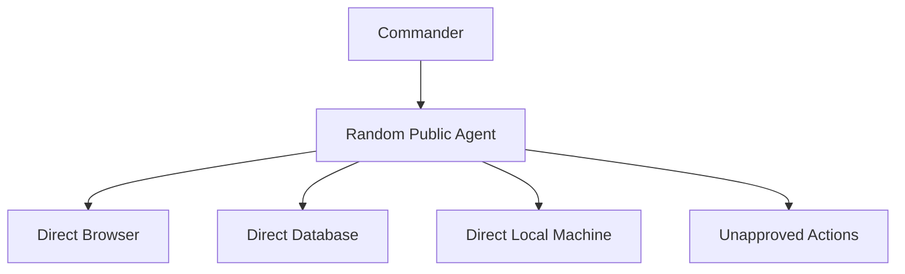
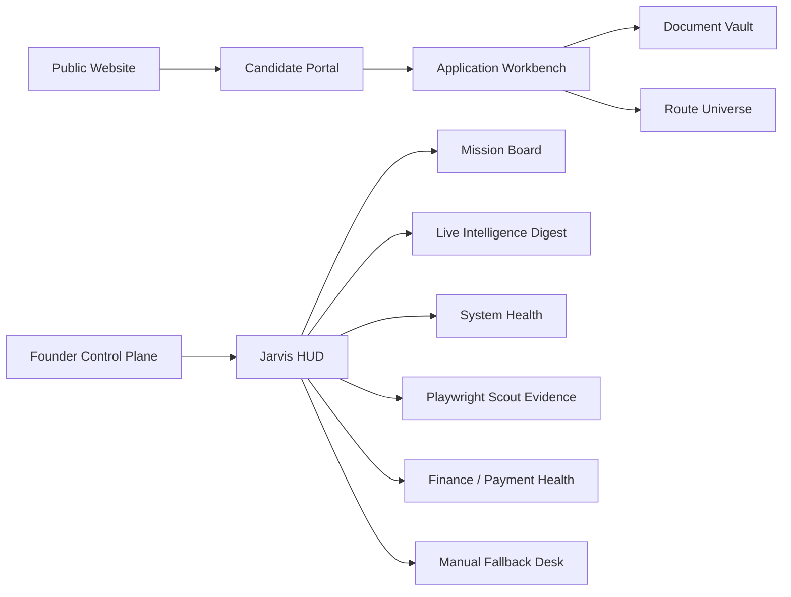
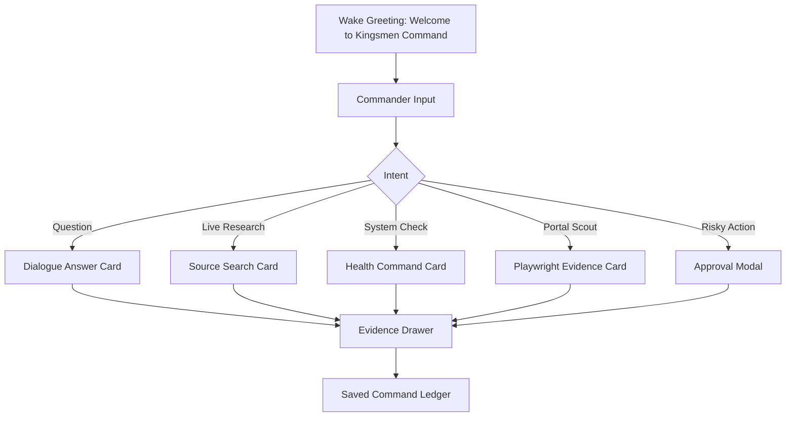

# KINGSMEN REAL JARVIS OPERATING MASTERPLAN

Status: Founder-locked build doctrine
Date locked: 2026-06-15
Owner: Kingsmen Commander
Purpose: Preserve the real Jarvis direction so the system is not lost, diluted, or reduced to a basic chat screen.

---

## 1. Core Decision

Kingsmen will build a real Jarvis, not a copied demo assistant.

Jarvis must become a Commander-only intelligence and command layer that can:

- hold smart dialogue like a powerful AI assistant,
- use live public data when freshness matters,
- use Kingsmen internal knowledge safely,
- inspect system health through approved routes,
- guide the Founder with evidence-backed answers,
- operate visually through a strong HUD and Control Plane,
- prepare reports, route maps, evidence packs, and safe next actions,
- remain under Kingsmen law, privacy rules, and approval gates.

Jarvis must not become:

- a public chatbot for candidates or partners,
- a free uncontrolled shell,
- an uncontrolled browser operator,
- a payment or official-status authority,
- a system that acts without evidence and approval.

---

## 2. Public Research Patterns Registered

The following public patterns are registered as inspiration only. Kingsmen will borrow patterns, not blindly install them into production.

| Pattern Source | Kingsmen Use | Adoption Level |
|---|---|---|
| Hermes-style agent | CLI, skills, memory, scheduled Founder reports, diagnostics | High as Founder-side pattern |
| OpenClaw Mission Control | Mission board, approvals, audit timeline, gateway control | High as Control Plane pattern |
| Browser Use / HyperAgent / Magnitude | Browser scout, recovery loops, visual checks, structured extraction | High for portal scouting only |
| AgentQL | Natural-language selectors and structured extraction | High for source and portal DNA |
| OpenJarvis | RSS/source monitoring, digesting, quality-gated content | Medium-high for intelligence digest |
| Simple Jarvis demos | Voice/HUD inspiration only | Low-medium |
| Multi-agent frameworks | Role separation, task handoff, evaluators | Medium, only under Kingsmen state machine |

---

## 3. Final Jarvis Hierarchy

Wrong hierarchy is forbidden:

---

## 4. Real Jarvis Capabilities

### A. Smart Dialogue

Jarvis must understand normal conversation and answer like a strong AI assistant.

It must support:

- general questions,
- Kingsmen architecture questions,
- live research questions,
- Founder decision questions,
- system health questions,
- command questions,
- visual dashboard explanations,
- document/report generation,
- voice interaction later.

### B. Live Data

Jarvis must know when live data is required.

Live-data examples:

- current deadlines,
- official pages,
- institution route changes,
- job and learnership updates,
- public policy changes,
- weather/time/utility facts,
- repo state,
- portal status,
- source-page updates.

### C. Kingsmen Knowledge

Jarvis must search Kingsmen knowledge before guessing.

Registered Kingsmen knowledge sources:

- doctrine and laws,
- pricing codex,
- N-series architecture,
- workflow registry,
- business pack,
- source registry,
- route universe,
- system reports,
- build evidence,
- command history summaries.

### D. Safe Memory

Jarvis memory must store:

- doctrine summaries,
- approved Founder preferences,
- system decisions,
- build history,
- public source intelligence,
- incident summaries,
- command outcomes.

Jarvis memory must not store raw private records, credentials, or sensitive operational material.

### E. Visual Intelligence

Jarvis must not remain a black-and-white chat box.

The interface must include:

- Jarvis HUD,
- animated status cards,
- command pills,
- evidence drawer,
- approval modal,
- mission board,
- live route map,
- portal scout screenshots,
- source-confidence badges,
- queue health panels,
- system pulse panels,
- mobile Founder view.

---

## 5. Visual Product Surfaces

Visual rule: every major Kingsmen surface must show status, next action, evidence, and risk. No empty black-and-white admin screens.

---

## 6. Build Roadmap From Beginning To Full Operation

### Phase 0 — Doctrine Lock

Goal: lock the laws before building more.

Deliverables:

- Kingsmen law file,
- Jarvis permission law,
- source-confidence bands,
- privacy and approval rules,
- public-agent pattern register,
- build roadmap.

Exit proof:

- doctrine files exist,
- validator confirms laws are readable,
- no module can claim readiness without proof.

### Phase 1 — Repo Foundation

Goal: make the monorepo stable and inspectable.

Deliverables:

- repo structure,
- environment templates,
- Next.js web app,
- backend API kernel,
- PostgreSQL migrations,
- local bootstrap,
- health endpoint,
- build validator.

Exit proof:

- local app starts,
- health endpoint responds,
- migrations apply,
- build passes.

### Phase 2 — Backend State Machine

Goal: backend controls all movement.

Deliverables:

- command envelope,
- candidate/application states,
- workflow result endpoint,
- idempotency,
- audit ledger,
- worker status,
- retry and failure handling.

Exit proof:

- no workflow controls the core state alone,
- every transition has evidence,
- duplicate requests are safe.

### Phase 3 — Data Vault

Goal: build the Kingsmen truth layer.

Deliverables:

- PostgreSQL schema,
- read models,
- evidence tables,
- source registry,
- route registry,
- document registry,
- finance registry,
- dashboard views.

Exit proof:

- database validates,
- read models power the UI,
- private access is restricted.

### Phase 4 — Candidate Portal

Goal: candidate can onboard without repeated typing.

Deliverables:

- account/session foundation,
- smart intake form,
- CV/document extraction support,
- profile correction review,
- application workbench,
- document upload centre,
- status page,
- email-first communication centre.

Exit proof:

- candidate can register,
- data can be reused from documents,
- candidate sees status and next steps.

### Phase 5 — Route Universe

Goal: Kingsmen can map real opportunities.

Deliverables:

- universities,
- TVET routes,
- CAO route handling,
- bursaries,
- NSFAS support,
- SETA and learnership routes,
- internships/employers,
- accommodation routes,
- verified source links,
- deadline and fee registry.

Exit proof:

- route matching works,
- source confidence is shown,
- stale sources are flagged.

### Phase 6 — Document Vault

Goal: documents become structured evidence.

Deliverables:

- upload gateway,
- document type detection,
- review status,
- missing document requests,
- evidence ledger,
- reusable profile extraction,
- safe storage references.

Exit proof:

- document status is visible,
- required documents are tracked,
- operators know what is missing.

### Phase 7 — Jarvis Intelligence Kernel

Goal: real Jarvis begins.

Deliverables:

- dialogue brain,
- intent router,
- tool router,
- answer composer,
- source confidence engine,
- command risk classifier,
- smart fallback messages,
- streaming response support.

Exit proof:

- Jarvis can answer general and Kingsmen questions,
- Jarvis chooses live lookup when required,
- Jarvis cites evidence or states uncertainty.

### Phase 8 — Jarvis Live Data Router

Goal: Jarvis becomes live.

Deliverables:

- live web research adapter,
- GitHub adapter,
- PostgreSQL read-model adapter,
- file/knowledge search adapter,
- Playwright scout adapter,
- utility adapters,
- result caching,
- evidence capture.

Exit proof:

- Jarvis can answer current facts with sources,
- Jarvis can inspect repo state,
- Jarvis can inspect system health,
- Jarvis can scout a public portal page safely.

### Phase 9 — Visual Jarvis HUD

Goal: move beyond black-and-white chat.

Deliverables:

- Commander wake screen,
- voice-ready state,
- command cards,
- live typing/streaming,
- tool-use animation,
- source badges,
- evidence drawer,
- mission board view,
- approval modal,
- mobile Founder view.

Exit proof:

- Founder can use Jarvis visually,
- every action shows status and proof,
- risky actions require approval.

### Phase 10 — Playwright Scout

Goal: live portal intelligence without unsafe automation.

Deliverables:

- portal health checks,
- deadline page checks,
- fee page checks,
- login page reachability,
- blocker detection,
- screenshot evidence,
- route DNA snapshots,
- manual package fallback.

Exit proof:

- portal evidence is saved,
- blockers route to manual,
- Jarvis never claims application success without proof.

### Phase 11 — Founder Control Plane

Goal: Founder can run Kingsmen from one command house.

Deliverables:

- mission board,
- candidate queue panels,
- route health panels,
- finance health panels,
- document pipeline,
- incidents,
- approvals,
- daily digest,
- workload view,
- cap and capacity view.

Exit proof:

- Founder can see what matters today,
- system surfaces bottlenecks,
- approvals and risks are visible.

### Phase 12 — Payments And Finance View

Goal: payments are tracked, not guessed.

Deliverables:

- package catalogue,
- orders,
- invoices,
- payment provider status,
- receipts,
- refund queue,
- finance digest,
- manual reconciliation view.

Exit proof:

- finance status is visible,
- no payment decision is made by AI alone,
- every paid package maps to service scope.

### Phase 13 — Workflow Workers

Goal: workflow automation becomes disciplined.

Deliverables:

- n8n or worker adapters,
- W00-W24 mapping,
- thin worker rule,
- backend result posting,
- retry handling,
- worker evidence,
- queue monitoring.

Exit proof:

- workers do not control core state,
- each worker returns one result,
- failure is recoverable.

### Phase 14 — Public Website

Goal: Kingsmen can sell and explain clearly.

Deliverables:

- public home,
- pricing page,
- service pages,
- free Destiny Map entry,
- CV revamp entry,
- accommodation support entry,
- trust/compliance pages,
- contact and onboarding path.

Exit proof:

- public users understand Kingsmen,
- pricing is clear,
- intake connects to portal.

### Phase 15 — Launch Operations

Goal: run with real users under a safe cap.

Deliverables:

- 500 active-candidate cap,
- founder reports,
- daily source checks,
- support workflow,
- manual fallback process,
- quality review,
- incident response,
- backup routine.

Exit proof:

- Kingsmen operates without chaos,
- Founder can see every important queue,
- system does not exceed safe capacity.

### Phase 16 — Scale Readiness

Goal: prepare for 1000, 5000, and beyond without rebuilding the business.

Deliverables:

- queue scaling,
- database indexes,
- worker concurrency rules,
- source-monitor scaling,
- operator roles,
- dashboard performance,
- audit exports,
- deployment hardening.

Exit proof:

- cap can rise by evidence,
- system quality remains visible,
- scaling does not remove capability.

---

## 7. Jarvis Visual HUD Blueprint

HUD components:

- top command bar,
- Jarvis voice orb,
- status pulse,
- mission cards,
- queue cards,
- evidence drawer,
- approval modal,
- source-confidence chips,
- live response stream,
- mobile commander layout.

---

## 8. Completion Definition

Kingsmen is full operating when:

1. candidates can onboard,
2. documents can be captured and reviewed,
3. routes can be matched with verified sources,
4. applications can be tracked through states,
5. payments and packages are visible,
6. Founder Control Plane shows live operations,
7. Jarvis can answer general, live, and Kingsmen-specific questions,
8. Jarvis can inspect safe system state,
9. Playwright scout can gather evidence,
10. manual fallback works,
11. communication is email-first with urgent escalation only,
12. every important action has proof,
13. capacity cap is enforced,
14. daily reports guide the Founder,
15. the system can run real users without losing control.

---

## 9. Non-Negotiable Rule

Jarvis must be powerful, intelligent, live, fast, visual, and useful.

But Jarvis must always remain:

Commander-only.
Evidence-backed.
Policy-gated.
Privacy-safe.
Source-aware.
Action-controlled.
Kingsmen-branded.

This document is now the master direction for Real Jarvis inside Kingsmen.
